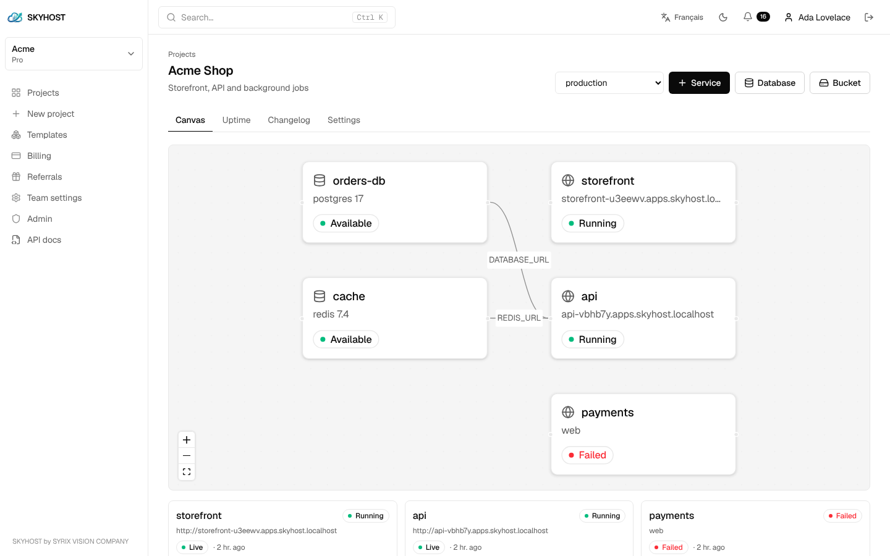
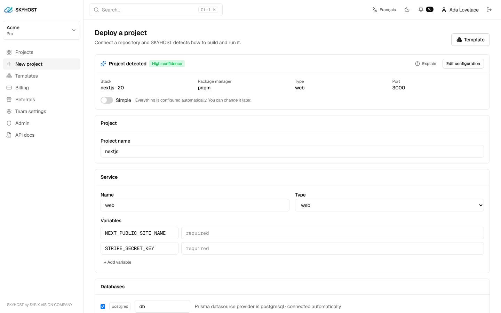
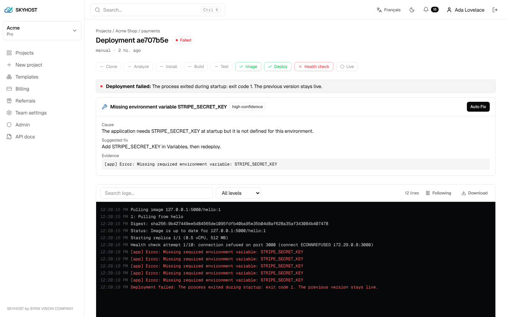
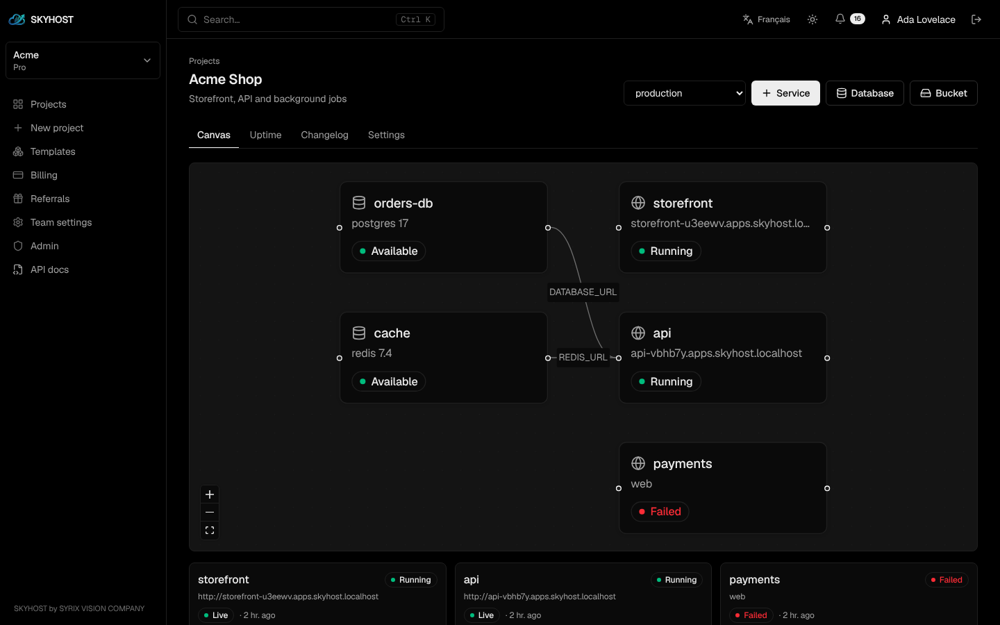

<div align="center">


# SKYHOST

**Push your code. Get a live URL.**

Deploy web apps, APIs, bots, cron jobs and databases in seconds — with HTTPS, logs and zero-downtime releases built in.

[**skyhost.tech**](https://skyhost.tech) · [Documentation](docs/getting-started.md) · [API reference](docs/api/reference.md) · [CLI](docs/cli.md) · [Examples](examples)

<a href="assets/skyhost-promo.mp4"></a>

<sub>▶ Click the preview to watch the full 50-second product video.</sub>

</div>

---

## What is SKYHOST?

SKYHOST is a hosting platform (PaaS) by **SYRIX VISION**. Connect a GitHub repository or drop a ZIP, and SKYHOST
detects your stack, builds it, runs it in an isolated sandbox and gives you a live HTTPS address such as
`https://my-app.skyhost.tech`. Every push redeploys automatically.

This repository is the **public developer kit** for SKYHOST:

| | |
| --- | --- |
| 🖥️ **[`cli/`](cli)** | The `skyhost` command line tool (open source, MIT) |
| 📘 **[`docs/`](docs)** | Getting started, CLI, API, webhooks, CI/CD, configuration guides |
| 🧩 **[`openapi/`](openapi)** | The OpenAPI 3 document of the public REST API (import it into Postman or Insomnia) |
| 📦 **[`examples/`](examples)** | Ready-to-deploy starters and API scripts (curl, Node.js, Python, GitHub Actions) |

> The SKYHOST platform itself (control plane, build workers, dashboard) is closed source and runs at
> [skyhost.tech](https://skyhost.tech). Everything here talks to it through the public API.

## Features

| | |
| --- | --- |
| ⚡ **SmartDeploy** | Detects Node.js, Next.js, Python, PHP, Go, static sites and Dockerfiles — build, start command and port included. |
| 🔁 **Zero-downtime releases** | Every release is health-checked before it receives traffic. One-click rollback. |
| 🩺 **Smart Error Analyzer** | A failed deploy tells you the cause and the fix — and opens the exact line in the editor. |
| ✏️ **Code editor** | Edit, commit and redeploy from the browser, on desktop or phone. |
| 🗄️ **Managed databases** | PostgreSQL, MySQL (MariaDB), MongoDB and Redis, with backups. |
| 🌐 **Domains & HTTPS** | Pretty `*.skyhost.tech` addresses and your own domains with free certificates. |
| 📈 **Logs & metrics** | Live logs, CPU / memory / network metrics, uptime checks and status pages. |
| 🔔 **Alerts everywhere** | Email, Telegram, WhatsApp, Slack, Discord and signed webhooks. |
| 🤖 **Workers & cron** | Bots, queue consumers and scheduled jobs, not just websites. |
| 🔐 **Secure by default** | gVisor sandboxes, encrypted variables, scoped API keys, 2FA. |

## Install the CLI

**macOS / Linux**

```bash
curl -fsSL https://raw.githubusercontent.com/INCONNU-BOY-SENSEI/skyhost/main/install.sh | sh
```

**Windows (PowerShell)**

```powershell
irm https://raw.githubusercontent.com/INCONNU-BOY-SENSEI/skyhost/main/install.ps1 | iex
```

**With npm** (any OS)

```bash
npm install -g github:INCONNU-BOY-SENSEI/skyhost
```

Node.js 18 or newer is required. Check it with `skyhost --version`.

## Deploy in 30 seconds

```bash
cd my-app
skyhost login      # approve this device in your browser
skyhost init       # create the project, upload, build and deploy
```

```text
Packaging 42 files (118 KB)…
✓ Created my-app and linked this directory
→ SmartDeploy: Next.js 15 · pnpm
→ Building… ✓ compiled successfully
→ Health check: GET / → 200 ✓
✓ Live at https://my-app.skyhost.tech
```

Then, from the same folder:

```bash
skyhost deploy             # ship a new version
skyhost logs -f            # follow the runtime logs
skyhost env set API_KEY=… --secret
skyhost db create postgres # managed database, DATABASE_URL injected
skyhost rollback           # back to the previous version
```

Full list: [docs/cli.md](docs/cli.md).

## Use the API

Create an API key in **[Account → API keys](https://skyhost.tech/account?tab=apikeys)**, then:

```bash
export SKYHOST_TOKEN=sky_xxxxxxxx_yyyyyyyyyyyy
curl -H "Authorization: Bearer $SKYHOST_TOKEN" https://skyhost.tech/api/v1/teams
```

```js
// Node.js 18+ — redeploy a service
const res = await fetch(`https://skyhost.tech/api/v1/services/${SERVICE_ID}/redeploy`, {
  method: "POST",
  headers: { Authorization: `Bearer ${process.env.SKYHOST_TOKEN}`, "Content-Type": "application/json" },
  body: JSON.stringify({ environmentId: ENVIRONMENT_ID }),
});
console.log((await res.json()).deployment.status);
```

- **Overview** (auth, errors, rate limits, realtime): [docs/api/README.md](docs/api/README.md)
- **Reference** (164 endpoints): [docs/api/reference.md](docs/api/reference.md)
- **Interactive explorer**: [skyhost.tech/api/docs](https://skyhost.tech/api/docs)
- **OpenAPI**: [openapi/skyhost.openapi.json](openapi/skyhost.openapi.json)

## Screenshots

<table>
<tr>
<td><br><sub>Project canvas — services, databases and how they connect</sub></td>
<td><br><sub>SmartDeploy — stack, commands, port and variables detected</sub></td>
</tr>
<tr>
<td><br><sub>Smart Error Analyzer — the cause and the fix of a failed deploy</sub></td>
<td><br><sub>Dark mode, English and French</sub></td>
</tr>
</table>

## Documentation

| Guide | |
| --- | --- |
| [Getting started](docs/getting-started.md) | Your first deployment, from the dashboard or the terminal |
| [CLI](docs/cli.md) | Every `skyhost` command and option |
| [App configuration](docs/configuration.md) | Ports, runtimes, Dockerfiles, variables, workers, cron, deploy strategies |
| [Databases](docs/databases.md) | Create, connect, back up and restore |
| [Custom domains](docs/domains.md) | DNS records and HTTPS |
| [CI/CD](docs/ci-cd.md) | GitHub Actions, deploy hooks, API keys |
| [Webhooks](docs/webhooks.md) | Events and signature verification |
| [Troubleshooting](docs/troubleshooting.md) | 502, build errors, crash loops |
| [API overview](docs/api/README.md) · [API reference](docs/api/reference.md) | Authenticate and automate everything |

## Support

- 💬 Dashboard: **[skyhost.tech/support](https://skyhost.tech/support)** (support tickets)
- 🐞 CLI bugs and doc fixes: [open an issue](https://github.com/INCONNU-BOY-SENSEI/skyhost/issues)
- 🔐 Security reports: see [SECURITY.md](SECURITY.md)

## License

The CLI, the documentation and the examples in this repository are released under the [MIT License](LICENSE).
"SKYHOST" and the SKYHOST logo are trademarks of SYRIX VISION COMPANY.

<div align="center"><br><sub><b>BY SYRIX VISION</b></sub></div>
